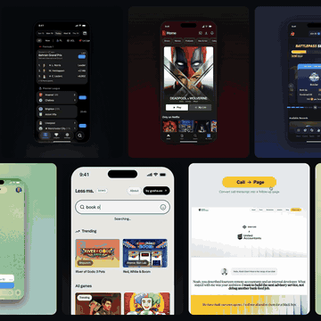

# feature-videos

Create product demo videos with your AI agent. Iterate in Flask, then render the final cut.

[](https://github.com/geknz/feature-videos/raw/refs/heads/main/media/skill-marquee.mp4)

[Watch or download the full-quality demo](https://github.com/geknz/feature-videos/raw/refs/heads/main/media/skill-marquee.mp4) · 36 seconds · 1440×1440 · 60 fps · silent

Seven demos made with this workflow and its earlier versions: Scoreboard, Minigames, Netflix Streaks, Battle Pass, Responsible Gambling, Less ms Search and United Custom Web.

Start with a **website, an app repository or Figma designs**, and describe the flow you want to show. The skill gives your agent a scene-based workflow, a reusable device frame, motion helpers and a renderer built for quick revisions.

## How it works

1. **Plan the scenes.** Turn the flow into actions, UI reactions and readable results. Define timing, camera positions and transitions.
2. **Build the animation.** Reuse product components and assets where available. For websites or Figma, the agent prepares a capture layer from the accessible UI and designs.
3. **Render a quick draft.** Default: 540×676, 30 fps, DPR1. Review the changed scenes and their boundaries first.
4. **Review in Flask.** The agent uploads a draft with sources and notes. Leave comments or record feedback while pointing at the video.
5. **Revise the affected scenes.** Ask the agent to read the feedback. Unchanged scene clips are reused; changes to shared styles, assets or dependencies invalidate the affected cache.
6. **Render the final cut.** Default: 1080×1350, 60 fps, DPR2 with downscaling. The agent checks the exported MP4 before delivery.

The goal is a short loop between feedback and the next version. Final-quality rendering happens when the edit is ready, rather than on every revision.

## Get started

```sh
git clone https://github.com/geknz/feature-videos.git ~/feature-videos
```

Open your product project in your coding agent and ask:

```text
Use ~/feature-videos/SKILL.md to create a demo video.
Source: [website URL, repository path or Figma link]
Flow: [what the viewer should see]

Split the flow into scenes and prepare a quick draft.
Upload it to Flask with source files and notes.
Return the link when the upload finishes.
```

For the next round:

```text
Read the new feedback on [Flask asset URL].
Apply it, check the changed scenes and upload the next draft
as a new version of the same asset. Keep the working parts.
```

When ready:

```text
Render the final version and check the complete MP4,
including scene transitions and the loop.
```

See [installation and requirements](docs/installation.md) and [the scene workflow](docs/how-it-works.md).

## What's included

- `SKILL.md` — agent instructions (Russian; the README and getting-started docs are English).
- `assets/starter/` — a small runnable capture project, scene cache and draft/final renderer.
- `scripts/new-project.py` — creates a new project without overwriting an existing folder.
- `assets/device-frame.*` — a reusable front-facing 390×844 CSS device frame.
- `assets/motion.*` and `assets/motion-tokens.json` — timing and linear motion helpers.
- `references/` — visual guidelines, device specification and a brief template.

The starter's sample UI demonstrates the pipeline. Your agent replaces it with the product UI; this is not a one-command website or Figma converter. Website and Figma access depends on your agent's tools and your permissions. Flask review requires a connected Flask integration; local exports work without it.

## Defaults

| | Draft | Final |
|---|---|---|
| Output | 540×676 | 1080×1350 |
| Frame rate | 30 fps | 60 fps |
| Device pixel ratio | 1 | 2, then downscale |
| Purpose | Feedback and iteration | Delivery |

H.264 MP4, no audio by default. Scenes use deterministic local time and local assets. Format, duration and motion can be changed for your brief.

The device is a custom CSS mockup, not an official Apple device asset. Product imagery and trademarks in visual references belong to their respective owners.
